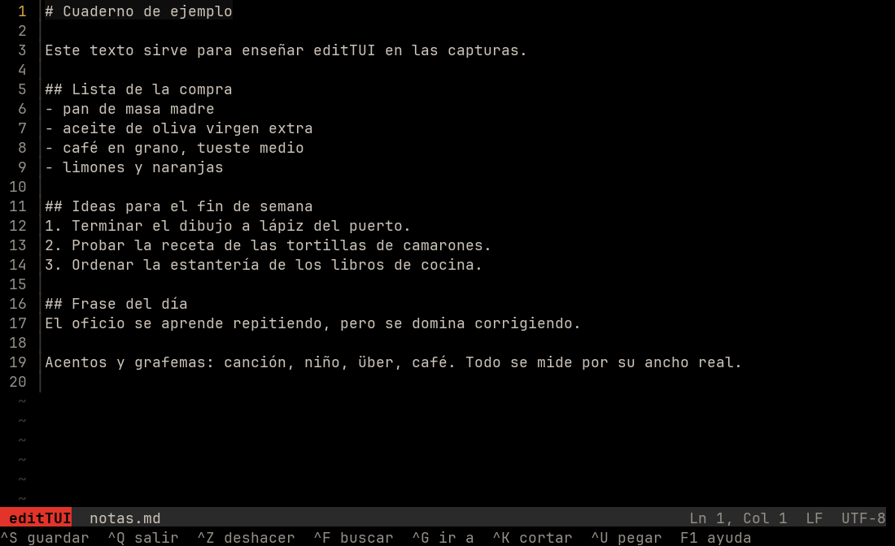
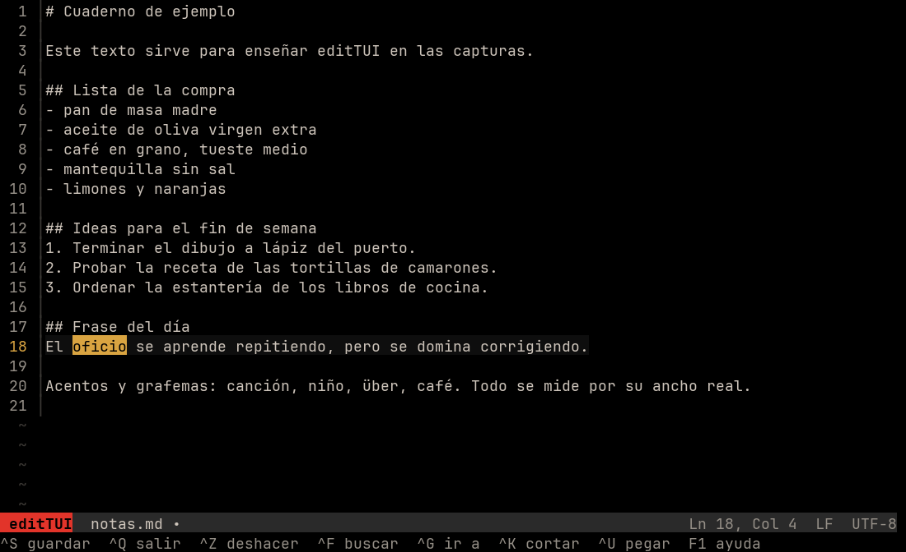
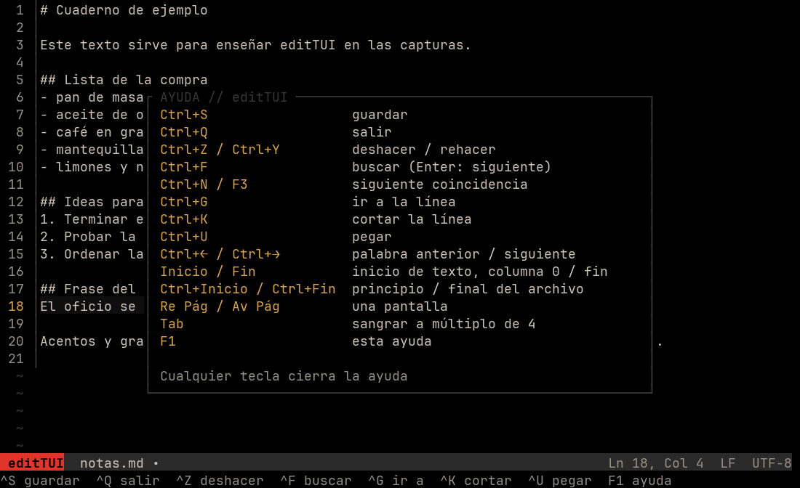

# editTUI

Editor de texto para el terminal, en Rust ([Ratatui](https://ratatui.rs)). Pensado para
TUI-OS, el sistema operativo de texto de la organización (se instala en `/usr/local/bin/edittui`), pero funciona en cualquier terminal.

| | |
|---|---|
|  |  |



*Capturas reales de la aplicación (120 columnas aprox., kitty/tmux) editando un texto de ejemplo.*

```sh
cargo run --release -- archivo.txt     # o sin argumentos: documento nuevo
```

## Teclas

| Tecla | Acción |
|---|---|
| `Ctrl+S` | guardar (pide nombre si no lo tiene) |
| `Ctrl+Q` | salir (pregunta si hay cambios sin guardar) |
| `Ctrl+Z` / `Ctrl+Y` | deshacer / rehacer (una racha de teclas es un solo paso) |
| `Ctrl+F`, `Ctrl+N` / `F3` | buscar (sin distinguir mayúsculas) y siguiente coincidencia |
| `Ctrl+G` | ir a la línea |
| `Ctrl+K` / `Ctrl+U` | cortar la línea / pegar |
| `Ctrl+←` `Ctrl+→` | palabra anterior / siguiente |
| `Inicio` / `Fin` | primer carácter con texto y columna 0 / fin de línea |
| `Ctrl+Inicio` / `Ctrl+Fin` | principio / final del archivo |
| `Tab` | sangra hasta el siguiente múltiplo de 4 (inserta espacios) |
| `F1` | ayuda |

Mantiene la sangría al pulsar Enter, respeta los grafemas (un acento combinante se mueve y
se borra con su letra), muestra caracteres anchos (CJK) con su ancho real y conserva el final
de línea del archivo (LF o CRLF) y su último salto de línea. Guarda de forma atómica
(archivo temporal y renombrado) y conserva los permisos.

## Límites (a propósito, de momento)

- Sin selección con Shift ni portapapeles del sistema: la consola de Linux no distingue
  Shift+flechas; el portapapeles es interno y de líneas enteras.
- Sin resaltado de sintaxis, varios búferes ni reemplazar.
- Rechaza archivos que no son UTF-8 y los de más de 16 MiB (todo el texto vive en memoria).
- Solo glifos de la fuente Terminus de la consola de Linux en su interfaz (el texto del archivo
  es el que sea).

## Desarrollo

```sh
cargo fmt --check && cargo clippy --all-targets -- -D warnings && cargo test
```

`document.rs` (texto, deshacer, E/S), `editor.rs` (cursor, comandos, teclas) y `text.rs`
(grafemas y anchos) no tocan el terminal y se prueban solos; `ui.rs` dibuja y se prueba con
`TestBackend`.

## Estado

Versión 0.1. En esta revisión se comprobó: `cargo fmt --check`, `cargo clippy -D warnings` y 28 pruebas en verde, y el uso real en un emulador de terminal (capturas de arriba).
No se ha vuelto a probar en la consola de Linux (TTY) en esta revisión.

## Licencia

[MIT](LICENSE).
